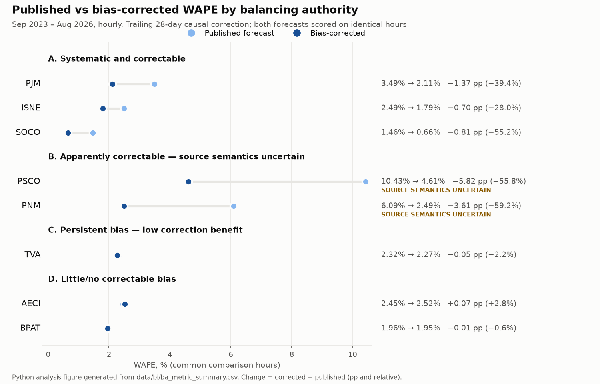
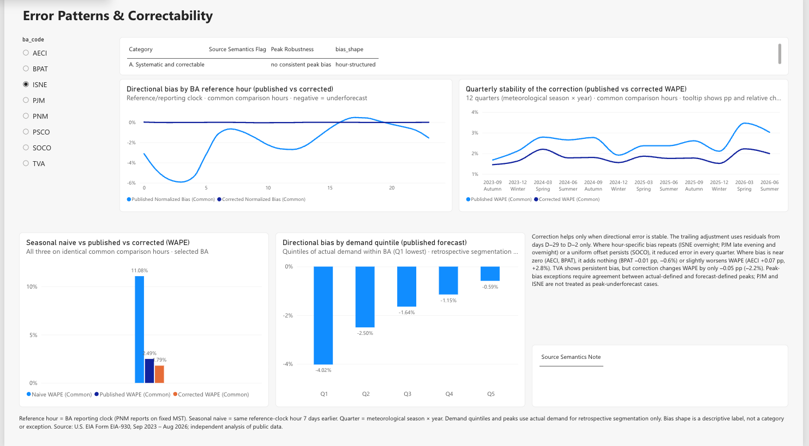

# Demand Forecast Performance & Operational Exceptions

Organizations routinely rely on forecasts they did not build themselves. This case study evaluates whether an existing operational forecast is reliable, where its errors are systematic, and whether simple historical post-processing can improve performance without replacing the incumbent forecasting process.

The setting is U.S. electricity demand. Balancing authorities (BAs) publish an hourly day-ahead demand forecast alongside the demand that followed, through the U.S. Energy Information Administration's Form EIA-930. The same evaluation applies to sales forecasts, demand plans, staffing and capacity models, and budget-versus-plan variance.

## Headline finding

**Forecast error was not equally correctable across systems.**
- **ISNE, PJM and SOCO** showed persistent directional bias. A simple, strictly causal historical adjustment reduced it in all 12 quarters.
- **AECI and BPAT** were already effectively unbiased, and the same adjustment gave little or no benefit (BPAT) or slightly worsened performance (AECI).
- **TVA** is a third case: persistent directional bias can exist without the correction reducing overall error enough to be worth applying.

| BA | Published → corrected WAPE | Change (pp) | Change (relative) | Quarters improved |
|---|---|--:|--:|--:|
| PJM | 3.49% → 2.11% | −1.37 | −39.4% | 12 / 12 |
| SOCO | 1.46% → 0.66% | −0.81 | −55.2% | 12 / 12 |
| ISNE | 2.49% → 1.79% | −0.70 | −28.0% | 12 / 12 |
| TVA | 2.32% → 2.27% | −0.05 | −2.2% | 10 / 12 |
| BPAT | 1.96% → 1.95% | −0.01 | −0.6% | 7 / 12 |
| AECI | 2.45% → 2.52% | +0.07 | +2.8% | 1 / 12 |

WAPE is the weighted absolute percentage error. Both forecasts are scored on identical hours (September 2023 – August 2026).



## Key findings

1. **The incumbent forecasts carry real skill.** For 6 of 8 BAs the published forecast removes 61–86% of the error of a seasonal-naive benchmark.
2. **Correctable error is directional and stable.** ISNE, PJM and SOCO underforecast by 1.3–1.8% of demand in every year. That stability is what a trailing correction can exploit.
3. **Aggregate accuracy hides hour-level bias.**
   - ISNE underforecasts by 3–6% overnight (00:00–05:00).
   - PJM underforecasts late evening and overnight, and overforecasts around 05:00–06:00.
   - Both patterns hold in every year, while overall WAPE sits at 2.5–3.5%. SOCO's bias is broadly uniform across hours.
4. **Where bias is absent, correction adds nothing.** AECI and BPAT show normalized bias of −0.02% and −0.06%.
5. **No BA's error is dominated by a handful of extreme hours.** The worst 1% of hours carry 2.9–6.3% of absolute error, close to the 3.6% expected for normally distributed error.

## Final categories

| BA | Category |
|---|---|
| ISNE | Systematic and correctable |
| PJM | Systematic and correctable |
| SOCO | Systematic and correctable |
| PNM | Apparently correctable — **SOURCE SEMANTICS UNCERTAIN** |
| PSCO | Apparently correctable — **SOURCE SEMANTICS UNCERTAIN** |
| TVA | Persistent bias — low correction benefit |
| AECI | Little/no correctable bias |
| BPAT | Little/no correctable bias |

## Management implications

- Retain the incumbent forecast where correction is small or unstable (AECI, BPAT, TVA).
- Consider targeted bias recalibration where improvement is persistent (ISNE, PJM, SOCO). Compare corrected and incumbent performance side by side over a further out-of-sample period before any operational use.
- Monitor recurring hour-specific bias separately from aggregate WAPE; a single KPI hides it.
- Keep source-semantic anomalies separate from forecast-performance conclusions.

A one-page summary is in [reports/executive_brief.md](reports/executive_brief.md).

## Scope and data

| Item | Detail |
|---|---|
| Source | U.S. EIA Form EIA-930 six-month BALANCE files and BA reference tables, retrieved 2026-09-24 (SHA-256 recorded) |
| Series | Hourly actual demand; published day-ahead demand forecast |
| Window | 36 complete months, 2023-09-01 to 2026-08-31, in each BA's reporting clock: 26,304 hourly observations per BA |
| Population | 8 BAs chosen from 50 that passed a ≥95% actual, forecast and paired coverage gate, on reporting stability and scale/geographic diversity, **before** any error metric was computed ([reports/ba_selection.md](reports/ba_selection.md)) |

## Analytical approach

The approach is question-led: source → data contract → validation → metrics → benchmarks → correctability → stability → exceptions → reporting. There is no machine learning; the question is how the existing forecast behaves, not how to build a better one. Full results are in [reports/forecast_performance_analysis.md](reports/forecast_performance_analysis.md).

## Forecast-performance definitions

Full formulas, numerators, denominators and limitations are in [docs/metric_catalogue.md](docs/metric_catalogue.md).

- **Sign convention:** error = forecast − actual, so positive means overforecast.
- **WAPE** (primary cross-BA measure): Σ|error| / Σactual.
- **MAE:** in MW, for magnitude within a BA.
- **Normalized bias:** Σerror / Σactual.
- **Peak WAPE:** on the top decile of actual demand per BA.
- **Worst-1% contribution:** the share of absolute error carried by the worst 1% of hours.

A large-miss threshold metric was evaluated and deliberately omitted. It turned out to be confounded by stable bias.

## Benchmark framework

- **Seasonal naive:** the same BA reporting-clock hour seven calendar days earlier, with deterministic handling of daylight-saving transitions. A strict 168-hour lag was checked as a sensitivity; naive WAPE moves by at most 0.014 pp.
- **Published forecast:** the incumbent, as reported.
- **Bias-corrected:** published forecast + the mean residual (actual − forecast) for the same BA and reporting hour over days D−29 to D−2. It uses prior data only, needs at least 14 days of history, and is never filled.

All three are compared on an identical set of hours. Incumbent KPIs are also reported on all paired hours.

## Correctability framework

- **Causality:** every corrected value is computed out of sample. Tests perturb the target day, the previous day and day D−30 and confirm the correction does not change; perturbing D−2 and D−29 does change it.
- **Stability:** improvement is reported by year and by quarter, never from one aggregate.
- **Rule:** the "practical improvement" rule is **project-defined**, not an industry threshold. Corrected WAPE must be at least 5% lower overall *and* lower in every year. Results always show the pp change, the relative change and the quarter count alongside it.
- **Peaks:** peak-bias exceptions require the pattern to survive both actual-defined and forecast-defined peaks. Selecting peaks by realized demand is retrospective and pulls bias toward underforecast. PJM's apparent peak underforecast disappears under the forecast-defined selection, so it is not treated as a finding.

## Data-quality controls

- **Canonical key:** BA + UTC hour, enforced unique, with a complete UTC grid per BA. Expected hours are counted from the UTC sequence.
- **Reporting clock:** each BA's reference time is verified against EIA's own local timestamps on every source row (0 mismatches). MISO and LGEE report fixed EST; PNM reports fixed MST.
- **Parsing:** strict numeric parsing, and conflicting duplicate keys fail the run.
- **Rejected values:** actuals that EIA's anomaly screening replaced are treated as missing. EIA-imputed values are never used, and missing forecasts are never imputed.
- **Coverage gate:** actual, forecast and paired coverage must each be ≥95%, plus monthly stability.
- **Tests:** 88 automated tests, including DST transition days drawn from real EIA rows. Details: [docs/data_contract.md](docs/data_contract.md).

## Source-semantic cautions

For **PNM** and **PSCO**, the reported forecast series contains a persistent level discrepancy (−5.8% and −9.4%; PSCO's gap has widened since January 2026). Available EIA metadata does not resolve whether this reflects forecast-process bias, reporting-scope differences, resubmission behaviour, or another source-definition effect.

EIA notes that forecasts follow each BA's operating accounting and that for some BAs the actual-vs-forecast comparison "is not very meaningful". Mathematical correctability in the reported series does not establish operational forecast-process failure. Neither BA is used as evidence for the headline finding. The audit is in [docs/source_semantics_audit.md](docs/source_semantics_audit.md).

## Power BI reporting layer

A two-page Power BI report was built in the Power BI Service on a semantic model with two star-schema relationships and the full DAX measure catalogue:
- **Forecast Performance Review:** equal-weighted BA KPI cards, published vs bias-corrected WAPE on common comparison hours, directional bias by BA, and an operating attention list that flags PNM and PSCO as SOURCE SEMANTICS UNCERTAIN.
- **Error Patterns & Correctability:** single-BA view of bias by reference hour, quarterly stability of the correction, seasonal naive vs published vs corrected, and bias by demand quintile.




**Reconciliation.** The service's DAX engine was checked against the Python pipeline. Every reconciled measure matches for all 8 BAs (largest difference 4.9e-07), and the rendered report values match those results ([docs/powerbi_reconciliation.md](docs/powerbi_reconciliation.md)).

**Documentation.**
- Model: [docs/semantic_model.md](docs/semantic_model.md), with a diagram at [docs/evidence/model_diagram.png](docs/evidence/model_diagram.png).
- Measures: [docs/dax_measures.md](docs/dax_measures.md).
- Report specification and as-built notes: [docs/report_spec.md](docs/report_spec.md).
- Extracts: [docs/bi_handoff.md](docs/bi_handoff.md).

A PDF export of both pages is at [reports/demand_forecast_performance.pdf](reports/demand_forecast_performance.pdf).

The .pbix file is not included because its embedded data source points to private storage. The DAX catalogue, model documentation and screenshots stand in for it.

## Reproducibility and refresh

One rerunnable pipeline goes from the official EIA files to every output: acquisition with provenance → validation → UTC and reporting-time normalization → coverage gate → metrics → benchmarks → bias correction → segmentation → BI-ready extracts.

```bash
python -m dfp.pipeline --start 2023-09-01 --end 2026-09-01 --bas PJM,ISNE,SOCO,TVA,AECI,BPAT,PNM,PSCO
```

Window and BA list are parameters. A rerun regenerates the curated fact, coverage outputs, benchmark and analytical tables, and BI extracts. The pipeline runs on demand; no refresh is scheduled. Setup, options and outputs are in [docs/workflow.md](docs/workflow.md).

## Repository structure

```
config/pipeline.toml     window, coverage gate, BA selection, analysis and exception parameters
src/dfp/                 acquisition, validation, timestamps, curation, benchmarks, metrics, analysis, BI extracts
tests/                   88 tests (DST, causality, reconciliation, BI extracts)
data/curated/            coverage tables and run manifest (hourly fact regenerated, not committed)
data/analysis/           segment metrics, correctability, stability, exceptions, reconciliation reference
data/bi/                 Power BI extracts (hourly fact regenerated, not committed)
docs/                    data contract, metric catalogue, source audit, workflow, Power BI model/DAX/report spec
docs/evidence/           Power BI model and report page screenshots
reports/                 BA selection, full analysis, executive brief, figure, Power BI PDF export
```

## Limitations

- **Revisions and vintage:** EIA revises values in place, and forecast vintage and resubmissions are not observable. The correction assumes forecasts are issued the day before and excludes the previous day's residuals.
- **Selection:** BAs were selected on reporting quality, which may favour operationally mature systems. Texas and California are not represented.
- **DST gaps:** PJM's daylight-saving transition days are blank in the source.
- **Seasons:** seasonal statements rest on three annual cycles.
- **PNM and PSCO:** their semantics remain unresolved (see above).
- **Impact:** no cost, reliability or operational impact is estimated. This is an independent analysis of public data.

## How to reproduce

```bash
python3.11 -m venv .venv && .venv/bin/pip install -e ".[test,figures]"
.venv/bin/python -m dfp.pipeline      # downloads EIA files (~290 MB) and regenerates all outputs
.venv/bin/python -m pytest
.venv/bin/python -m dfp.figures
```

## Technology

Python (pandas, pyarrow), pytest, matplotlib for the static figure, and Power BI (semantic model, DAX, Power Query) for the reporting layer.
