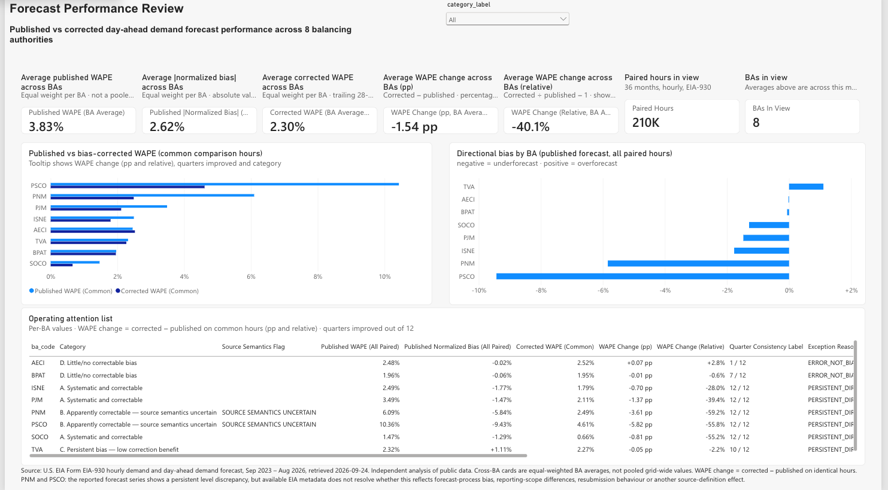

# Demand Forecast Performance & Operational Exceptions

Teams often rely on forecasts they did not build. This project looks at how reliable one such forecast is, where its errors are systematic, and whether a simple historical adjustment can improve it without replacing the existing forecasting process.

The setting is U.S. electricity demand. Balancing authorities (BAs) publish an hourly day-ahead demand forecast alongside actual demand through the U.S. Energy Information Administration's Form EIA-930. The same review works for sales forecasts, demand plans, staffing models or budget-versus-plan variance.

## Headline finding

**Forecast error was not equally correctable across systems.**
- **ISNE, PJM and SOCO** had persistent directional bias. A simple historical bias correction reduced it in all 12 quarters.
- **AECI and BPAT** were already close to unbiased (normalized bias −0.02% and −0.06%). The same correction did little for BPAT and made AECI slightly worse.
- **TVA** had persistent bias too, but correcting it reduced overall error too little to be worth applying.

| BA | Published → corrected WAPE | Change (pp) | Change (relative) | Quarters improved |
|---|---|--:|--:|--:|
| PJM | 3.49% → 2.11% | −1.37 | −39.4% | 12 / 12 |
| SOCO | 1.46% → 0.66% | −0.81 | −55.2% | 12 / 12 |
| ISNE | 2.49% → 1.79% | −0.70 | −28.0% | 12 / 12 |
| TVA | 2.32% → 2.27% | −0.05 | −2.2% | 10 / 12 |
| BPAT | 1.96% → 1.95% | −0.01 | −0.6% | 7 / 12 |
| AECI | 2.45% → 2.52% | +0.07 | +2.8% | 1 / 12 |

WAPE is weighted absolute percentage error. Both forecasts are scored on the same hours, September 2023 – August 2026. PNM and PSCO are discussed [separately](#pnm-and-psco).


## Key findings

1. **The published forecasts are already strong.** For 6 of 8 BAs they remove 61–86% of the error of a seasonal-naive benchmark.
2. **The correctable error is directional and stable.** ISNE, PJM and SOCO underforecast by 1.3–1.8% of demand in every year, the kind of consistent bias a trailing correction can remove.
3. **Aggregate accuracy hides hour-level bias.** ISNE underforecasts by 3–6% overnight (00:00–05:00). PJM underforecasts late evening and overnight, and overforecasts around 05:00–06:00. Both patterns hold in every year while overall WAPE sits at 2.5–3.5%. SOCO's bias is broadly uniform across hours.
4. **Large misses are not concentrated in a few hours.** The worst 1% of hours account for 2.9–6.3% of absolute error, close to the 3.6% expected for normally distributed errors.

## Results by BA

| BA | Category |
|---|---|
| ISNE | Systematic and correctable |
| PJM | Systematic and correctable |
| SOCO | Systematic and correctable |
| PNM | Apparently correctable — source semantics uncertain |
| PSCO | Apparently correctable — source semantics uncertain |
| TVA | Persistent bias — low correction benefit |
| AECI | Little/no correctable bias |
| BPAT | Little/no correctable bias |

## Recommendations

- Keep the published forecast where correction is small or unstable (AECI, BPAT, TVA).
- For ISNE, PJM and SOCO, consider recalibrating for bias, after running the corrected and published forecasts side by side for a further period.
- Track hour-of-day bias alongside overall WAPE, which hides it.
- Leave PNM and PSCO out of performance conclusions until their source definitions are confirmed.

A one-page summary is in [reports/executive_brief.md](reports/executive_brief.md).

## Scope and data

| Item | Detail |
|---|---|
| Source | U.S. EIA Form EIA-930 six-month BALANCE files and BA reference tables, retrieved 2026-09-24 |
| Series | Hourly actual demand; published day-ahead demand forecast |
| Window | 36 complete months, 2023-09-01 to 2026-08-31: 26,304 hourly observations per BA |
| Population | 8 BAs chosen from the 50 with at least 95% of hours carrying both an actual and a forecast value, for reporting stability, scale and geographic spread. The selection was made before any error metric was computed ([reports/ba_selection.md](reports/ba_selection.md)) |

## Approach

The published forecast is compared with two alternatives on the same hours: a seasonal-naive benchmark and a historical bias correction. Error is forecast minus actual, so positive values mean overforecasting. WAPE is the main accuracy measure, supported by MAE and normalized bias. Definitions are in the [metric catalogue](docs/metric_catalogue.md).

- **Seasonal naive:** the same hour one week earlier.
- **Published:** the forecast as reported.
- **Bias-corrected:** the published forecast plus the average error for the same BA and hour over the previous four weeks, leaving out the day immediately before.

The correction uses only earlier data, and automated tests check that later values cannot change it. Improvement is checked by year and by quarter rather than on one overall figure, and counts as practical only if WAPE falls by at least 5% overall and falls in every year. An apparent PJM underforecast at peak hours was not reported because it disappears when peaks are defined by forecast rather than actual demand. The full analysis is in [reports/forecast_performance_analysis.md](reports/forecast_performance_analysis.md).

## Data quality

Before scoring, the pipeline checks timestamps, duplicates, coverage and missing values. Missing actuals or forecasts are not filled. Full validation rules, including time-zone and daylight-saving handling, are in the [data contract](docs/data_contract.md).

## PNM and PSCO

PNM and PSCO are included in the data and Power BI report but excluded from the headline finding. Their reported forecasts remain 5.8% and 9.4% below actual demand, but EIA metadata does not make clear whether that gap reflects forecast bias or differences in how the series are reported. See the [source-semantics audit](docs/source_semantics_audit.md).

## Power BI report

A two-page report built in the Power BI Service, with a semantic model and DAX measures:
- **Forecast Performance Review:** KPI cards, published vs bias-corrected WAPE, directional bias by BA, and an attention list that flags PNM and PSCO.
- **Error Patterns & Correctability:** one BA at a time, showing bias by hour, quarterly stability of the correction, the three forecasts side by side, and bias by demand level.




The report's measures match the Python outputs for all 8 BAs ([reconciliation](docs/powerbi_reconciliation.md)). A PDF of both pages is at [reports/demand_forecast_performance.pdf](reports/demand_forecast_performance.pdf).

The .pbix file is not included because its data connection points to private storage. The [DAX measures](docs/dax_measures.md), [semantic model](docs/semantic_model.md) and [report specification](docs/report_spec.md) describe the report instead.

## Repository structure

```
config/pipeline.toml     window, coverage gate, BA selection, analysis and exception parameters
src/dfp/                 acquisition, validation, timestamps, curation, benchmarks, metrics, analysis, BI extracts
tests/                   time handling, correction, reconciliation and BI extract tests
data/curated/            coverage tables and run manifest (hourly fact regenerated, not committed)
data/analysis/           segment metrics, correctability, stability, exceptions, reconciliation reference
data/bi/                 Power BI extracts (hourly fact regenerated, not committed)
docs/                    data contract, metric catalogue, source audit, workflow, Power BI model/DAX/report spec
docs/evidence/           Power BI model and report page screenshots
reports/                 BA selection, full analysis, executive brief, figure, Power BI PDF export
```

## Limitations

- **Revisions and vintage:** EIA revises values in place, and forecast vintages and resubmissions are not visible. The correction assumes forecasts are issued the day before.
- **Selection:** BAs were selected on reporting quality, which may favour operationally mature systems. Texas and California are not represented.
- **DST gaps:** PJM's daylight-saving transition days are blank in the source.
- **Seasons:** seasonal statements rest on three annual cycles.
- **Impact:** no cost, reliability or operational impact is estimated.

## Reproduce locally

Requires Python 3.11+.

```bash
python3.11 -m venv .venv && .venv/bin/pip install -e ".[test,figures]"
.venv/bin/python -m dfp.pipeline      # downloads EIA files (~290 MB) and regenerates all outputs
.venv/bin/python -m pytest
.venv/bin/python -m dfp.figures
```

The window and BA list can be changed with `--start`, `--end` and `--bas`; see [docs/workflow.md](docs/workflow.md).

## Technology

Python (pandas, pyarrow), pytest, matplotlib for the static figure, and Power BI (semantic model, DAX, Power Query) for the reporting layer.
